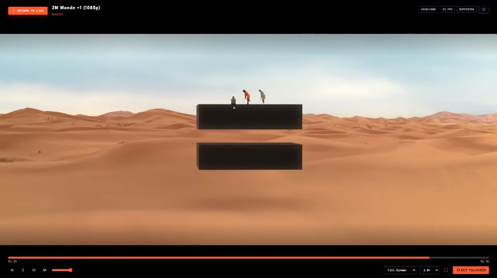
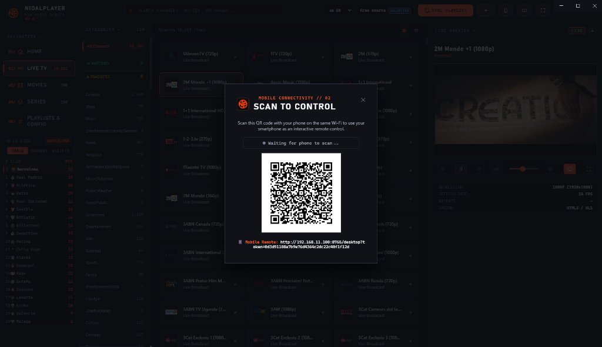

# Nidalplayer — Ultra HD M3U Stream & Cinema Player (Windows)

**Nidalplayer** is an advanced, high-performance streaming media center engineered specifically for Windows. Built with an ultra-responsive dark Liquid Glass design system, Nidalplayer provides a cinema-grade desktop experience for streaming IPTV live television, on-demand movies, and TV series with zero-latency channel zapping, instant seeking, and seamless smartphone companion remote control.

> [!IMPORTANT]
> ### ⚠️ NO PLAYLISTS OR CONTENT INCLUDED
> **Nidalplayer is strictly a media player software client.** It **does NOT contain, host, provide, broadcast, or bundle any playlists, TV channels, movies, series, or video streams of any kind**.
>
> **You must provide and enter your own legally acquired playlist (M3U playlist URL or Xtream Codes login credentials) to stream content.**
>
> *All demonstration channels and movies shown in promotional screenshots utilize strictly Creative Commons open-source media (Blender Open Projects) and public domain / free-to-air feeds for illustrative purposes only.*

---

## 🚀 What Nidalplayer Includes

* **⚡ Ultra-Low Latency Streaming Engine**:
  * High-compatibility synthetic chunked HLS byte-range streaming engine with instant (<150ms) playback startup.
  * Rapid seeking (+10s / -10s) across movies, episodes, and VOD streams without buffer stalls.
  * Multi-track audio and subtitle selection supporting all standard audio formats (AAC, MP3, AC3, EAC3).
  * Driver-managed GPU hardware acceleration with automatic software-rendering fallback on driver crash.

* **📺 Dual Fullscreen & Cinema Docking**:
  * **In-Window Borderless Player (`F` / In-HUD Toggle)**: Expands playback to fill the entire application window without taking over your desktop or multi-monitor setup.
  * **Whole-Monitor Cinema Fullscreen (`F11` / In-HUD Expander)**: Takes the stream into dedicated OS display fullscreen for immersive home theater viewing.
  * **Side-by-Side Preview Panel**: Stream channels and VODs in an active live preview pane while continuing to browse categories, playlists, and guides.

* **🎬 Smart VOD & TV Series Cinema Hub**:
  * High-density virtualized scroller running at fluid 60 FPS across libraries containing hundreds of thousands of items.
  * **4K TMDB Metadata Enrichment**: Cleans stream titles and automatically fetches official posters, backdrops, ratings, plot synopses, and cast details.
  * **Season & Episode Inspector**: Full TV series browser with watched progress indicators, resume timestamps, and episode summaries.
  * **Flexible Sorting & Category Curation**: Newest-added-first sorting with category-aware display headers.

* **⚽ Top 5 Football Leagues Match Center**:
  * Integrated real-time match fixtures, live scores, and schedules for Premier League, La Liga, Serie A, Bundesliga, Ligue 1, and UEFA Champions League.
  * **Sidebar Favorite Team Sports Center**: Live league standings, top scorers, and top assists for your selected favorite club.
  * Starting XI lineups and tactical formations displayed when published by live sports feeds.

* **📱 Flat Night HUD Mobile Companion Remote**:
  * Scan the in-app QR code with any smartphone on your local Wi-Fi to launch an instant touch remote control — no app store download required.
  * Battery-efficient flat Night HUD theme optimized for high-contrast OLED mobile screens.
  * Full playback controls, D-Pad navigation, volume slider, and live channel switching from your couch.

* **🌍 Multi-Language & Windows 11 Integration**:
  * Native localized interface in **English**, **Arabic (العربية)**, **French (Français)**, **Spanish (Español)**, and **German (Deutsch)**.
  * Tailored for Windows 10 & 11 with keyboard shortcuts cheatsheet (`F1` / `?`).
  * Built-in silent background auto-updater with 1-click restart patching via GitHub Releases.

---

## 📸 Interface Showcase

| Live Television & EPG Guide | Fullscreen Cinema Mode |
| :---: | :---: |
|  |  |

| Home Hub & Match Center | Mobile Remote Pairing (Scan to Control) |
| :---: | :---: |
|  |  |

---

## 📥 Downloads (Windows x64)

| Release Package | File | Size | Description |
| :--- | :--- | :--- | :--- |
| **Windows Installer** | [`Nidalplayer-Setup-4.6.0.exe`](https://github.com/nidal0xp/Nidalplayer/releases/download/v4.6.0/Nidalplayer-Setup-4.6.0.exe) | ~112.3 MB | Standard Windows setup with desktop and Start Menu shortcuts |
| **Portable Edition** | [`Nidalplayer-Portable-4.6.0.exe`](https://github.com/nidal0xp/Nidalplayer/releases/download/v4.6.0/Nidalplayer-Portable-4.6.0.exe) | ~99.9 MB | Standalone portable executable, no installation required |
| **Update Manifest** | [`latest.yml`](https://github.com/nidal0xp/Nidalplayer/releases/download/v4.6.0/latest.yml) | ~350 B | SHA-512 update verification manifest |

*Compatible with Windows 10 and Windows 11 (64-bit).*

---

## 🔄 Version Updates & Changelog

For the complete history of updates, new features, and technical improvements for each release, please visit the official [GitHub Releases](https://github.com/nidal0xp/Nidalplayer/releases) page.

---

## ⚖️ Legal & Disclaimer

Nidalplayer is strictly a standalone software media player client and aggregator. **It does not host, provide, broadcast, or distribute any media content or playlists.** Users are exclusively responsible for supplying their own legitimate streams. For full details, please review our [DISCLAIMER](DISCLAIMER.md).

---

## 📜 License & Terms of Use

Nidalplayer is proprietary closed-source software. All rights reserved.

* ✅ **Personal Use**: You are welcome to download, install, and use official binary releases for personal, non-commercial media playback.
* ❌ **Proprietary & Closed-Source**: Reverse engineering, decompilation, resale, commercial distribution, or bundling with paid services is strictly prohibited.

For complete terms and conditions, see the [LICENSE](LICENSE) file.
