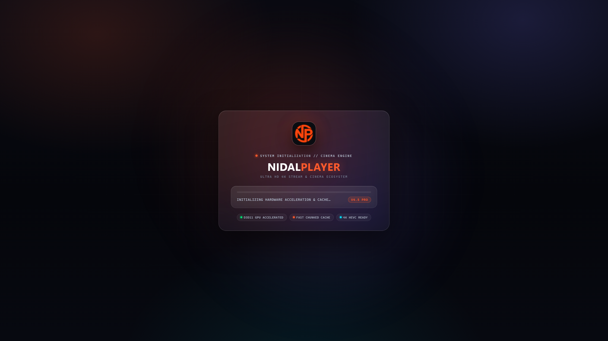

# Nidalplayer — Ultra HD M3U Stream & Cinema Player (Windows)

**Nidalplayer** is a high-performance streaming media center engineered for Windows. Version **4.5.0 "Glass Edition"** rebuilds the desktop client, the phone remote and the Windows installer on a single dark glass design system, and fixes the live-stream pipeline so buffering, failures and retries are reported truthfully.

---

## ✨ What's New in 4.5.0

* **Glass design system** — frosted panels, soft depth and consistent spacing across Home, Live, Movies, Series and Settings.
* **New boot experience** — animated glass splash instead of the old white flash.
* **Redesigned mobile remote** — status header, volume, transport controls, D-pad and channel shortcuts, matching the desktop.
* **Dark installer** — custom NSIS artwork and wizard theme instead of the stock white setup screens.
* **Live playback fixes** — live items stay `buffering` until the decoder is ready, with a 15 s startup watchdog and an offline placeholder when a stream is unreachable.
* **Security hardening** — sandboxed renderer, no Chromium security bypass switches, scoped certificate exceptions, escaped playlist metadata.

See the full [release notes](https://github.com/nidal0xp/Nidalplayer/releases/tag/v4.5.0) for details.

---

## 📸 Showcase

| Live Television | Movies & Cinema |
| :---: | :---: |
|  |  |

| TV Series | Mobile Companion Remote |
| :---: | :---: |
|  |  |

   
  <em>Boot splash · Windows desktop media center · smartphone web remote</em>

---

## 📱 Mobile Companion Web Remote

Scan the in-app QR code with any smartphone on your local Wi-Fi to launch the instant touch remote control — no phone app download required.

---

## 🚀 Key Features

* **⚡ Ultra-Low Latency Streaming Engine**:
  * Zero-delay stream initiation (<150ms startup).
  * High-compatibility synthetic byte-range M3U8 chunking for instant seeking (+10s / -10s) across all movies, episodes, and VOD streams.
  * Multi-track audio and subtitle selection with universal codec support (AAC, MP3, AC3, EAC3).
  * **Driver-Managed GPU Acceleration**: Chromium selects supported graphics features; repeated recent GPU crashes trigger a software-rendering fallback.

* **🎬 Integrated Cinema Preview & VOD Grid**:
  * Side-by-side instant playback preview panel with audio controls, synopsis display, and one-click cinema fullscreen mode.
  * High-density virtualized grid supporting hundreds of thousands of entries with 60 FPS fluid scrolling.
  * Real-time search reticle across live feeds, movies, and TV series.

* **⚽ Top 5 Football Leagues Match Center & Live Sidebar Widget**:
  * Real-time match fixtures, live scores, and schedules for Premier League, La Liga, Serie A, Bundesliga, Ligue 1, and UEFA Champions League.
  * **Sidebar Favorite Team Sports Center**: Live league standings table with active club highlight, plus one-touch switches for Top Scorers and Top Assists.
  * EPG-assisted broadcaster suggestions ranked from available playlist and programme data; results are best-effort when provider EPG data is incomplete.
  * Match lineups and formations are shown when published by available match data; unavailable details are clearly identified rather than guessed.

* **🌟 4K TMDB Metadata Enrichment**:
  * Clean title sanitization strips codec and release tags to fetch original 4K backdrops, posters, ratings, plot synopses, and cast headshots.
  * **User-Configurable**: Easily connect your own free [The Movie Database (TMDB)](https://www.themoviedb.org/settings/api) API key directly in **Settings > Playback & Performance Config**.

* **📱 Smartphone Companion Remote Control**:
  * Scan an in-app QR code with any smartphone camera to launch a responsive, touch-optimized web remote control over LAN. No phone app installation required.

* **🔄 Silent Background Auto-Updates**:
  * Built-in background auto-updater automatically checks for new releases on GitHub, downloads patches in the background, and prompts with a 1-click restart notification.

---

## 📥 Downloads (Windows x64)

| Release Package | File | Size | Description |
| :--- | :--- | :--- | :--- |
| **Windows Installer** | [`Nidalplayer-Setup-4.5.0.exe`](https://github.com/nidal0xp/Nidalplayer/releases/download/v4.5.0/Nidalplayer-Setup-4.5.0.exe) | ~90 MB | Standard Windows setup with desktop and Start Menu shortcuts |
| **Portable Edition** | [`Nidalplayer-Portable-4.5.0.exe`](https://github.com/nidal0xp/Nidalplayer/releases/download/v4.5.0/Nidalplayer-Portable-4.5.0.exe) | ~89 MB | Standalone portable executable, no installation |
| **Update Manifest** | [`latest.yml`](https://github.com/nidal0xp/Nidalplayer/releases/download/v4.5.0/latest.yml) | 350 B | SHA-512 update verification manifest |

Requires Windows 10/11 x64.

---

## ⚖️ Legal & Disclaimer

Nidalplayer is strictly a standalone software media player and client aggregator. **It does not host, provide, broadcast, or distribute any media content or playlists.** Users are exclusively responsible for supplying their own legitimate streams. For full details, please review our [DISCLAIMER](DISCLAIMER.md).

---

## 🤝 Contributing

Contributions, bug reports, and enhancements are welcome! Please review [CONTRIBUTING.md](CONTRIBUTING.md) for local development and pull request guidelines.

---

## 📜 License & Terms of Use

This project is licensed under the **Creative Commons Attribution-NonCommercial-ShareAlike 4.0 International (CC BY-NC-SA 4.0)** license with an anti-commercial clause.

### Summary of Terms:
* ✅ **Free for Personal Use**: You are welcome to download, use, study, modify, and share this software for non-commercial personal entertainment.
* ❌ **Commercial Sale is Strictly Prohibited**: You may **NOT** sell, resell, rent, lease, charge fees for, or bundle Nidalplayer (or any modified derivative) with paid services, hardware, or subscriptions.
* ℹ️ **Attribution**: Any distributed forks or derivatives must retain original attribution and be licensed under the same terms.

For full legal terms, see the [LICENSE](LICENSE) file.
