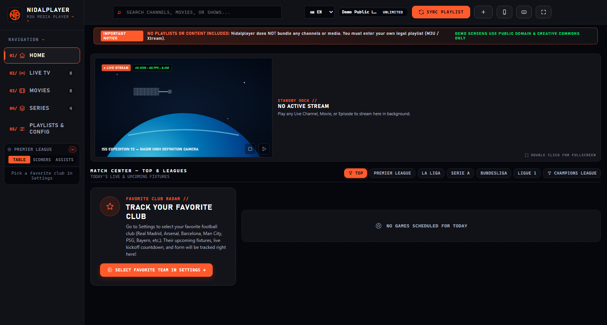
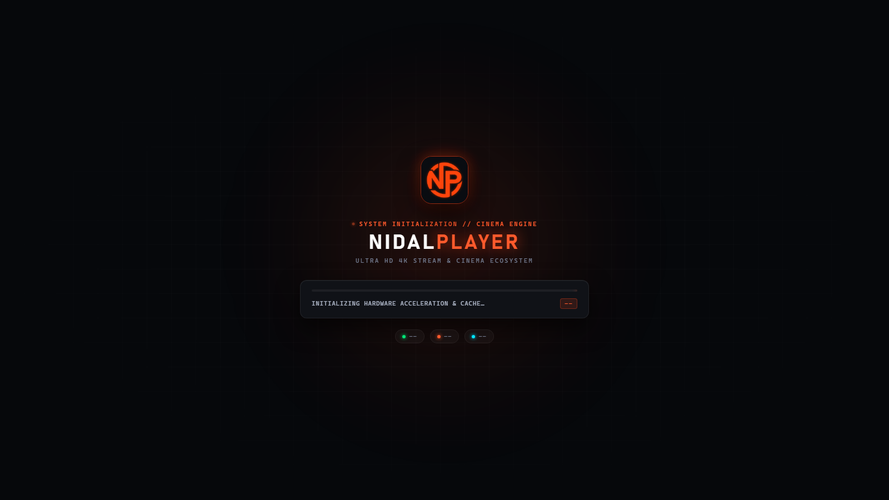
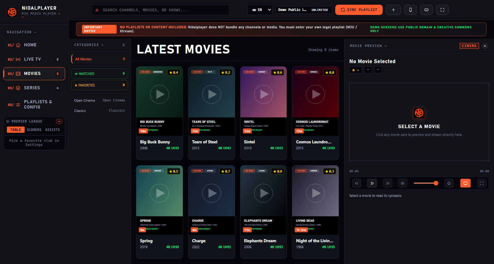
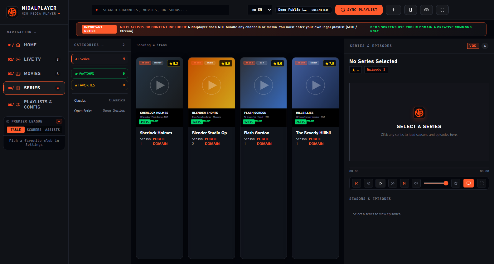
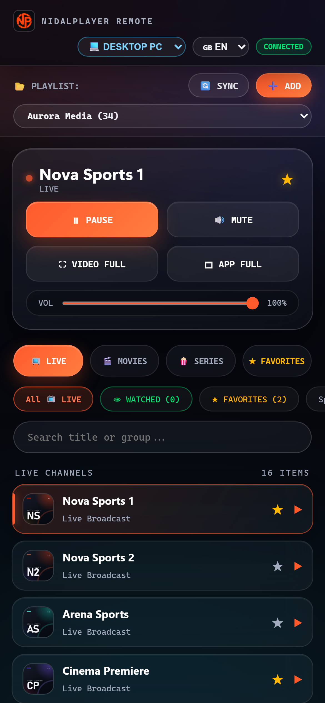

# Nidalplayer — Ultra HD M3U Stream & Cinema Player (Windows)

**Nidalplayer** is a high-performance streaming media center engineered for Windows. Version **4.6.0 "Night HUD Edition"** delivers a decoupled dual-fullscreen architecture, newest-first movies grid curation with a category-aware display heading, deterministic stature-curated football marquee matchups, and a battery-efficient flat Night HUD mobile remote.

> [!IMPORTANT]
> ### ⚠️ NO PLAYLISTS OR CONTENT INCLUDED
> **Nidalplayer is strictly a media player client software.** It **does NOT contain, host, provide, or bundle any playlists, TV channels, movies, series, or video streams of any kind**.
>
> **Users must supply and enter their own valid, legally acquired playlist (M3U URL or Xtream Codes credentials) to stream content.**
>
> *All demonstration channels and movies shown in screenshots are strictly public domain, Creative Commons (Blender Open Projects), or free-to-air public broadcasters used exclusively for UI demonstration.*

---

## ✨ What's New in 4.6.0

* **🎬 Dual Fullscreen Architecture (Toggle Borderless vs. Monitor Fullscreen)**:
  * **App-Only Toggle (`F` / Dock Toggle)**: Fills the entire application window borderless without taking over the monitor.
  * **Monitor Fullscreen (`F11` / Dock Fullscreen)**: Takes the stream into whole-monitor OS cinema fullscreen.
  * **In-HUD Fullscreen Control**: Switch directly between App Borderless and Whole Monitor view from inside the player controls without exiting.
  * **Symmetric Exit Lifecycle**: Exiting playback cleanly restores native window dimensions without leaving the desktop trapped in monitor fullscreen.
  * **Natural Double-Click**: Double-click any dock preview to enter whole-monitor cinema; double-click the expanded video viewport to restore back to dock.

* **🍿 Movies Grid Newest-Added-First**:
  * Movies automatically sort newest-added first via Xtream timestamps (`added` DESC), with honest `providerOrder` fallback for playlist formats without timestamps.
  * **Category-Aware Display Heading**: Prominent display heading dynamically displays **LATEST MOVIES** for default view, switching to the active category or status (Watched / Favorites) with automatic ellipsis truncation.

* **⚽ Top 5 Football Match Center: Stature-Based Curation**:
  * Curated big-club global stature across Premier League, La Liga, Serie A, Bundesliga, Ligue 1, and UEFA Champions League.
  * Instant, deterministic, zero-network curation eliminates empty standings fallbacks or API rate-limits.
  * Canonical alias normalization for club naming variants across live scoreboards.

* **📱 Flat Night HUD Mobile Companion Remote**:
  * Redesigned mobile companion on obsidian/slate flat design tokens (`--bg-obsidian`, `--bg-surface`, `--border-subtle`, `--accent-orange`), matching desktop design.
  * Removed heavy CSS glassmorphism blur and gradient glows for maximum mobile rendering performance and battery efficiency.
  * Full catalog parity with desktop newest-added-first sorting.

* **⚡ Windows 11 Polish & Performance**:
  * Reserved in-HUD top padding in borderless mode to prevent native Windows caption buttons (`— ▢ ✕`) from overlapping telemetry badges.
  * Fluid 60 FPS VirtualScroller DOM rendering and GPU compositor transition safety.

---

## 📸 Showcase

| Live Television | Movies & Cinema |
| :---: | :---: |
|  |  |

| TV Series | Mobile Companion Remote |
| :---: | :---: |
|  |  |

---

## 📱 Mobile Companion Web Remote

Scan the in-app QR code with any smartphone on your local Wi-Fi to launch the instant touch remote control — no phone app download required.

---

## 🚀 Key Features

* **⚡ Ultra-Low Latency Streaming Engine**:
  * Zero-delay stream initiation (<150ms startup).
  * High-compatibility synthetic byte-range M3U8 chunking for instant seeking (+10s / -10s) across all movies, episodes, and VOD streams.
  * Multi-track audio and subtitle selection with universal codec support (AAC, MP3, AC3, EAC3).
  * Driver-managed GPU acceleration with automatic software-rendering fallback on driver crash.

* **🎬 Integrated Cinema Preview & VOD Grid**:
  * Side-by-side instant playback preview panel with audio controls, synopsis display, and one-click cinema fullscreen mode.
  * High-density virtualized grid supporting hundreds of thousands of entries with 60 FPS fluid scrolling.
  * Real-time search reticle across live feeds, movies, and TV series.

* **⚽ Top 5 Football Leagues Match Center & Live Sidebar Widget**:
  * Real-time match fixtures, live scores, and schedules for Premier League, La Liga, Serie A, Bundesliga, Ligue 1, and UEFA Champions League.
  * Sidebar Favorite Team Sports Center with live standings, top scorers, and top assists.
  * Starting XI lineups and formations displayed when published.

* **🌟 4K TMDB Metadata Enrichment**:
  * Clean title sanitization strips codec and release tags to fetch original 4K backdrops, posters, ratings, plot synopses, and cast headshots.
  * User-configurable API key in Settings.

* **🔄 Silent Background Auto-Updates**:
  * Built-in background auto-updater checks for new releases on GitHub, downloads patches in the background, and prompts with a 1-click restart notification.

---

## 📥 Downloads (Windows x64)

| Release Package | File | Size | Description |
| :--- | :--- | :--- | :--- |
| **Windows Installer** | [`Nidalplayer-Setup-4.6.0.exe`](https://github.com/nidal0xp/Nidalplayer/releases/download/v4.6.0/Nidalplayer-Setup-4.6.0.exe) | ~117.7 MB | Standard Windows setup with desktop and Start Menu shortcuts |
| **Portable Edition** | [`Nidalplayer-Portable-4.6.0.exe`](https://github.com/nidal0xp/Nidalplayer/releases/download/v4.6.0/Nidalplayer-Portable-4.6.0.exe) | ~104.8 MB | Standalone portable executable, no installation |
| **Update Manifest** | [`latest.yml`](https://github.com/nidal0xp/Nidalplayer/releases/download/v4.6.0/latest.yml) | ~350 B | SHA-512 update verification manifest |

*Requires Windows 10/11 x64.*

---

## ⚖️ Legal & Disclaimer

Nidalplayer is strictly a standalone software media player and client aggregator. **It does not host, provide, broadcast, or distribute any media content or playlists.** Users are exclusively responsible for supplying their own legitimate streams. For full details, please review our [DISCLAIMER](DISCLAIMER.md).

---

## 📜 License & Terms of Use

Nidalplayer is proprietary closed-source software. All rights reserved.

* ✅ **Personal Use**: You are welcome to download, install, and use official binary releases for personal, non-commercial media playback.
* ❌ **Proprietary & Closed-Source**: Reverse engineering, decompilation, resale, commercial distribution, or bundling with paid services is strictly prohibited.

For complete terms and conditions, see the [LICENSE](LICENSE) file.
